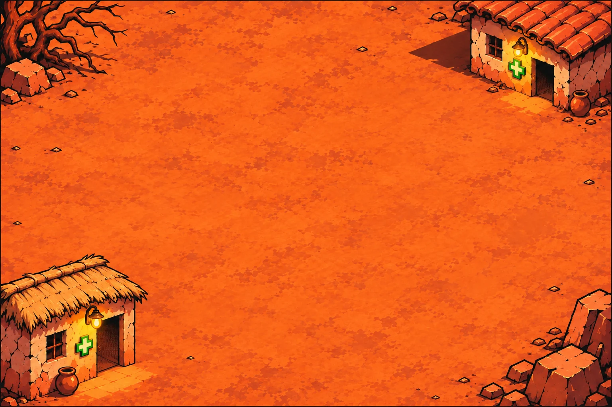

# Usar poses articuladas na arena de Chagasico

**Aceita · 27 de novembro de 2026**

**Protótipo jogável em avaliação.** Abra Chagasico em Meus cursos. [Jogar o rancho ao entardecer](https://lobulo-hepatico-atlas-viral.matraca130.chatgpt.site/rancho-chagasico.html)

## Contexto

O rancho ao entardecer segue a prancha arcade T5–T8. O chão laranja é aberto e as duas casas de adobe ficam nas bordas. A proposta original inclui uma senhora com chinelo, iscas vermelhas e uma pergunta sobre a moradia. [Proposta das rotas](https://github.com/Matraca130/elgamee/pull/7)

## Referências visuais

| Uso | Arquivo |
| --- | --- |
| Ilustração de referência da composição | [Burnt orange ranch with healing cottages.png](https://chatgpt.com/library?file_id=libfile_77a18149ff5c819188156047746fb517&account_id=personal) |
| Imagem limpa usada para preparar o fundo | [Burnt-orange arcade ranch arena.png](https://chatgpt.com/library?file_id=libfile_3c3e95b57fd481919c3cba38f2342947&account_id=personal) |
| Fundo versionado que a arena carrega | [dist/rancho-arena.webp](../../dist/rancho-arena.webp) |
| Poses renderizadas que a arena carrega | [dist/rancho-poses.webp](../../dist/rancho-poses.webp) |



## Jogo atual e pontos de reuso

| Componente | Como funciona no Atlas | Onde adaptar |
| --- | --- | --- |
| Movimento e mira | No celular e no tablet, a esquerda move e a direita mira e dispara em toques independentes. No computador, WASD ou setas movem, o mouse pressionado mira e dispara e J pressionado ataca com mira assistida. Espaço ou o botão Dash desvia. O ataque automático é opcional. | Reutilize [dist/controles-arena.js](../../dist/controles-arena.js), usado por [Influenza e VSR](../../dist/jogo.js) e pelo [rancho](../../dist/rancho-chagasico.js). A arena fornece a posição na tela e aplica as entradas ao combate. |
| Cenário e encontro | O rancho tem duas casas de cura, uma senhora que lança chinelos, armadilhas e uma saída. | Ajuste posições, colisões e regras do encontro em [dist/rancho-modelo.js](../../dist/rancho-modelo.js). Ajuste a apresentação em [dist/rancho-chagasico.js](../../dist/rancho-chagasico.js). |
| Arte e animação | O fundo e a folha de poses são carregados na arena. Os quadros marcados acionam soltura e impacto. | Trabalhe sobre os arquivos desta página e o [rig de referência](../../art/rancho/rancho-animacoes.blend). Ao trocar o fundo, confira a posição das casas e armadilhas no modelo. |

Para retomar, use `npm run contexto -- retomar chagasico`, confira as decisões no MemPalace e abra a fase publicada. Se uma adaptação mexer em uma regra aceita, como a distribuição dos controles, leve a divergência ao criador com seus efeitos antes de escolher.

## Decisão

- Abrir a arena pelo botão Chagasico em Meus cursos e aplicar os mesmos controles de arena do Atlas.
- Reusar o método definido para Influenza e Toxocara. O desenho é formado por peças 2D articuladas no Blender, exportadas em poses transparentes. O jogador usa repouso, deslocamento, esquiva, ataque e reação ao dano. A senhora tem repouso, preparação, soltura e recuperação. Cada armadilha tem repouso, compressão e golpe.
- Usar o quadro marcado de soltura para disparar o projétil. A senhora mira no chão durante a preparação e o chinelo percorre um arco ao sair da mão. A armadilha mostra o alcance antes do impacto. Um ataque do jogador pode interromper a armadilha.
- Recuperar vida e oferecer uma evolução na primeira visita a cada casa. As opções de Refúgio em frestas e Atividade noturna recebem peso maior no sorteio. O acerto da pergunta inicial e a escolha das duas opções preparam o bônus noturno. Visitar as duas casas abre a saída. [Transmissão e hábitos da vinchuca](https://www.argentina.gob.ar/salud/chagas/chagas-y-la-vinchuca)

## Editar o rig

O [arquivo Blender](../../art/rancho/rancho-animacoes.blend) contém a senhora, a armadilha, o personagem e o chinelo em voo. Os marcadores da linha do tempo indicam a soltura e o impacto. O [script do rig](../../art/rancho/montar-rig.py) gera o arquivo Blender, a folha de poses e o manifesto usado pela arena.

```sh
blender -b -t 4 -P art/rancho/montar-rig.py -- /tmp/rancho-poses.png
magick /tmp/rancho-poses.png -strip -define webp:lossless=true dist/rancho-poses.webp
npm run build
```

O [modelo da partida](../../dist/rancho-modelo.js) usa o manifesto para marcar a soltura e o golpe. A [página da arena](../../dist/rancho-chagasico.html) usa a folha de poses para desenhar os personagens sobre o cenário.
